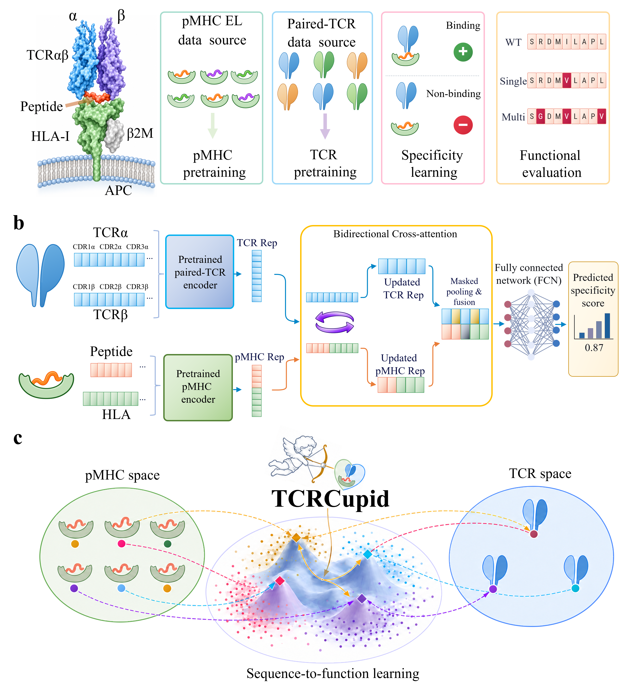

# TCRCupid

Code and evaluation resources for *TCRCupid: generalizable sequence-to-function learning decodes antigen specificity of T-cell receptors*.



Protein language models have advanced sequence-based prediction of T-cell antigen specificity. However, translating T-cell receptor (TCR) and peptide–major histocompatibility complex (pMHC) sequences into functional predictions that generalize to unseen epitopes and resolve the effects of epitope mutations remains challenging. Here, we present TCRCupid, a sequence-to-function learning framework coupling a pretrained paired-TCR encoder with ESM2-based class I pMHC encoders through bidirectional residue-level attention. Systematic comparisons of the pMHC encoders reveal that model scale and fine-tuning depth shape the functional utility of ESM2 representations differently across immune scenarios. TCRCupid generalizes specificity prediction to strict epitopes unseen evaluation and predicts T-cell activation across epitope mutation scans. Furthermore, we fine-tuned recognition-informed components for downstream neoantigen immunogenicity prediction, informing retrospective survival stratification after immune checkpoint blockade, and enables pMHC-conditioned β-chain complementarity-determining region 3 (CDR3β) candidate generation within specified receptor backgrounds. Together, TCRCupid provides a reusable computational foundation for investigating adaptive immune function and prioritizing immunotherapeutic candidates.

## Installation

Use Python 3.12 or later. Run the commands below from the repository root.

```bash
conda create -n tcrcupid python=3.12 -y
conda activate tcrcupid
```

For GPU inference, install the PyTorch build that matches your CUDA environment in the activated environment. [PyTorch installation](https://pytorch.org/get-started/locally/)

```bash
python -m pip install -r requirements.txt
```

The ESM2 checkpoints use Transformers 5.17.0, pinned in `requirements.txt`. The repository supplies ESM2 configurations and tokenizers. The TCRCupid checkpoints supply the model parameters.

## Download datasets

The [Zenodo deposit][zenodo] is pending. The record ID and archive names below are placeholders for the planned release.

Download `tcrcupid-datasets.zip` to the directory above this repository. The archive should contain a top-level `datasets/` directory. Extract it from the repository root.

```bash
python -m zipfile -e ../tcrcupid-datasets.zip src
```

The expected location is `src/datasets/`. It contains the evaluation splits, reference inputs for repertoire analysis, and archived scores and summaries for metric recomputation. Specificity splits derive from the IEDB and VDJdb data provided through IMMREP25. [IMMREP25 data](https://www.kaggle.com/competitions/immrep25/data) · [VDJdb licence](https://github.com/antigenomics/vdjdb-db/blob/master/LICENSE)

## Download model weights

Download `tcrcupid-weights.zip` from the same [Zenodo deposit][zenodo]. Place the archive one directory above the repository. Its top-level `weights/` directory should extract to `src/weights/`.

```bash
python -m zipfile -e ../tcrcupid-weights.zip src
```

The checkpoint bundle includes the strict specificity model, a separate retained-10X model, five fold-specific models, five ESM2 pMHC presentation models with their matching heads, and the paired TCR encoder.

## Repository layout

```text
assets/figure1.png   Framework diagram
configs/             Model, tokenizer and specificity evaluation settings
requirements.txt     Runtime dependencies
src/
  data/              Input readers and preprocessing
  models/            TCRCupid model definitions
  datasets/          Local evaluation inputs from Zenodo
  weights/           Local checkpoints from Zenodo
  specificity.py     TCR–pMHC specificity evaluation
  presentation.py    pMHC presentation evaluation
  embedding.py       TCR encoding, retrieval and repertoire geometry
  *_metrics.py       Metrics for the archived benchmark outputs
```

Git ignores `src/datasets/`, `src/weights/` and generated `results/`.

## Evaluate the saved models

### TCR–pMHC specificity

Run the strict unseen-epitope test (2,278 pairs across 58 epitopes), the retained-10X test (1,648 pairs), or internal five-fold cross-validation (19,822 pairs). Each test uses its matching checkpoint.

```bash
python -m src.specificity --split strict --hla-normalize --hla-center-alpha 0.02 --output-dir results/strict
python -m src.specificity --split strict_with_10x --output-dir results/strict_with_10x
python -m src.specificity --split cv --output-dir results/cv
```

Each command writes `metrics.json` and a prediction CSV per split or fold. The strict command reports raw metrics and HLA-wise score transformations using the manuscript's centring coefficient. Omit `--hla-center-alpha` to fit the coefficient on the saved validation split. The CV command reports fold-level metrics, mean and sample standard deviation, and pooled out-of-fold metrics. In the original internal CV protocol, each held-out fold was used for epoch selection and reporting.

### pMHC presentation

Evaluate the presentation tower and its matching head on the 7,153-pair eluted-ligand test set.

```bash
python -m src.presentation --size 150M
```

The available ESM2 sizes are `8M`, `35M`, `150M`, `650M` and `3B`. Results are printed as JSON. Use `--batch-size` to reduce memory usage and `--precision fp32` on devices with limited bfloat16 support. The 3B variant contains two ESM2-3B encoders and requires more memory than the smaller models.

### Paired TCR representations, retrieval and geometry

First encode the 49,309 receptors. Then use the embedding archive for the 10-target nearest-reference retrieval benchmark and the 1,000-receptor geometry analysis.

```bash
python -m src.embedding encode --receptors src/datasets/embedding/01_tcrs.csv --checkpoint src/weights/embedding/paired_tcr.pt --output results/tcr_embeddings.npz
python -m src.embedding retrieve --embeddings results/tcr_embeddings.npz --benchmark src/datasets/embedding --output results/retrieval
python -m src.embedding geometry --embeddings results/tcr_embeddings.npz --cohort src/datasets/embedding/geometry_random.csv --baseline tcrdist src/datasets/embedding/tcrdist --baseline protbert src/datasets/embedding/protbert --pgen src/datasets/embedding/pgen.csv --output results/geometry
```

Retrieval writes per-target and macro-averaged CSVs. Add `--target <target_id>` to run a single target or `--scratch <directory>` to place temporary distances on a different disk. Geometry writes distance correlations, neighbourhood overlap and Pgen correlations using the archived TCRdist, ProtBert and OLGA inputs.

## Recompute metrics from archived results

These commands print JSON and use the archived outputs in `src/datasets/`.

| Evaluation | Inputs and reported results |
| --- | --- |
| Immunogenicity | Saved scores for 937 Neoantigen and 2,345 Infectious observations. Recomputes AUROC, AUPR, PPVn and other classification metrics for the full cohorts and the subsets stratified by exact training peptide–HLA overlap. |
| CDR3β generation | Saved per-pMHC summaries for TCRCupid, TCR-TRANSLATE, TCRDiff and GRATCR across 200 pMHC groups. Recomputes sequence recovery, novelty and Hit@K for all four models and native-token perplexity for the three likelihood-based models. |
| AlphaFold 3 | Saved structure summaries for 20 complexes, the 16 supervised-training-unseen β–pMHC pairs, and three tumour-antigen cases (7PHR, 7Q99 and 7Q9A). Recomputes structural metrics and paired comparisons. |

```bash
python -m src.immunogenicity_metrics
python -m src.generation_metrics
python -m src.structure_metrics --cohort all20
python -m src.structure_metrics --cohort unseen16
python -m src.structure_metrics --cohort tumor_cases
```

Perplexity uses each likelihood-based model's native tokenizer. The archived generation summaries cover 1,622 test records and 1,610 generation contexts.

For the structural subset, an unseen pair means the exact native CDR3β, peptide and HLA pseudosequence combination was absent from the audited TCRCupid supervised training inputs. The structural summaries derive from previously computed AlphaFold 3 predictions. [AlphaFold 3 paper](https://www.nature.com/articles/s41586-024-07487-w) · [AlphaFold 3 output terms](https://github.com/google-deepmind/alphafold3/blob/main/OUTPUT_TERMS_OF_USE.md)

## Acknowledgements

The ESM2 configurations and tokenizers originate from Meta's ESM2 distribution. The HLA class I lookup uses PUFFIN-compatible pseudosequences. [ESM2 licence](configs/ESM2-LICENSE.txt) · [PUFFIN licence](configs/PUFFIN-LICENSE.txt)

## Contact

For questions about the code, assets or reproducing the evaluations, please email [Qaing Yang](mailto:yangq@stu.hit.edu.cn) or [Gongning Luo](mailto:luogongning@hit.edu.cn).

[zenodo]: https://zenodo.org/records/TCRCUPID_RECORD_ID
